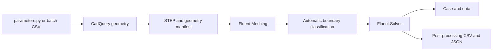

# NETmix CFD Automation

[](LICENSE)

**Parametric CAD generation, numerical meshing and photocatalytic CFD simulation using CadQuery and Ansys Fluent.**

This repository automates the construction and simulation of NETmix reactors, from geometric parameters to CFD results. The workflow supports individual reactors, reuse of existing geometries and meshes, and sequential batch studies.



## Contents

- [1. Requirements and installation](#1-requirements-and-installation)
- [2. Repository structure](#2-repository-structure)
- [3. Configuration](#3-configuration)
- [4. Single-reactor workflows](#4-single-reactor-workflows)
- [5. Batch studies](#5-batch-studies)
- [6. Output files and naming](#6-output-files-and-naming)
- [7. Boundary identification and validation](#7-boundary-identification-and-validation)
- [8. Legacy physics and UDFs](#8-legacy-physics-and-udfs)
- [9. Troubleshooting](#9-troubleshooting)
- [10. Verification status and limitations](#10-verification-status-and-limitations)
- [11. Command reference](#11-command-reference)

## 1. Requirements and installation

### 1.1 Software

The working reference environment is Windows, Python 3.12, Ansys Fluent Student 2026 R1 and PyFluent 0.43.1. Other Fluent releases and operating systems may require changes to the launcher, meshing tasks, settings API and UDF compilation commands.

Install the following separately before setting up the Python environment:

- [Python 3.12](https://www.python.org/downloads/) (64-bit).
- [Visual Studio Code](https://code.visualstudio.com/) and the Microsoft Python extension (`ms-python.python`).
- Ansys Fluent 2026 R1, with a valid Student or commercial license. PyFluent does not install Fluent itself.
- Optional: the OCP CAD Viewer VS Code extension (`bernhard-42.ocp-cad-viewer`) for interactive CAD previews.

The reference installation compiled C UDFs using Fluent's built-in Clang compiler, without a separate Visual Studio C++ compiler. Compiler requirements may differ on other installations. Respect the mesh-size and processor limits of your Fluent license.

### 1.2 Open the repository in VS Code

Clone or extract the repository into a short local path, preferably without spaces or cloud synchronization, for example `C:\Python_CadQuery`. In VS Code, select **File > Open Folder** and open the repository root. Open **Terminal > New Terminal** and choose PowerShell.

```powershell
cd C:\Python_CadQuery
```

All subsequent commands assume the terminal is in this folder.

### 1.3 Create and activate a virtual environment

Check that Python 3.12 is installed:

```powershell
py -3.12 --version
```

Create an isolated environment and activate it:

```powershell
py -3.12 -m venv .venv312
.\.venv312\Scripts\Activate.ps1
```

If PowerShell blocks the activation script, a session-only policy change may be used where permitted:

```powershell
Set-ExecutionPolicy -Scope Process -ExecutionPolicy RemoteSigned
.\.venv312\Scripts\Activate.ps1
```

Alternatively, without changing execution policy, run commands using `.\.venv312\Scripts\python.exe` instead of `python`.

In VS Code, press `Ctrl+Shift+P`, choose **Python: Select Interpreter**, and select `.venv312\Scripts\python.exe`. Open a new terminal if necessary. Verify the interpreter:

```powershell
python --version
python -c "import sys; print(sys.executable)"
python -m pip install --upgrade pip
```

The executable path should point to `.venv312`, not the global Python installation.

### 1.4 Install the Python libraries

Use the following reference versions for the updated 2026 R1 workflow:

```powershell
python -m pip install cadquery==2.8.0 cadquery-ocp==7.9.3.1.1 cadquery-ocp-proxy==7.9.3.1.1 ocp-vscode==4.3.0 ocp-tessellate==3.7.0
python -m pip install ansys-fluent-core==0.43.1 numpy
python -m pip check
```

| Package | Purpose |
| --- | --- |
| `cadquery` | Parametric solid modeling and STEP export |
| `cadquery-ocp`, `cadquery-ocp-proxy` | Open CASCADE geometry bindings and supporting interface |
| `ocp-vscode`, `ocp-tessellate` | CAD visualization in VS Code |
| `ansys-fluent-core` | Fluent launch, meshing, solver control and numerical reports |
| `numpy` | Geometric classification and numerical arrays |

The other imports used by the controllers (e.g. `argparse`, `csv`, `json`, `pathlib`, `hashlib`) are part of Python's standard library.


Verify imports and installed versions:

```powershell
python -c "import cadquery, numpy, ansys.fluent.core; print('Imports OK')"
python -c "from importlib.metadata import version; print(version('cadquery')); print(version('ansys-fluent-core'))"
python main.py --help
python batch_run.py --help
```

If the viewer is needed, open the OCP CAD Viewer panel and select `SHOW_VIEW = 'fluid'` or `'boundaries'` in `parameters.py`. Set `SHOW_VIEW = 'none'` for noninteractive runs.

### 1.5 Configure the Fluent installation

In `parameters.py`, adjust the installation paths to your machine. Example for the Student installation used in development:

```python
FLUENT_VERSION = '26.1.0'
ANSYS_ROOT = r'C:\Program Files\ANSYS Inc\ANSYS Student\v261'
FLUENT_PATH = r'C:\Program Files\ANSYS Inc\ANSYS Student\v261\fluent\ntbin\win64\fluent.exe'
PROCESSORS = 4
SHOW_GUI = True
```

Check the executable path in PowerShell:

```powershell
Test-Path 'C:\Program Files\ANSYS Inc\ANSYS Student\v261\fluent\ntbin\win64\fluent.exe'
```

A result of `True` confirms that the file exists. Commercial installations may have a different directory structure. The current launcher in `meshing_setup.py` must be the updated 2026 R1 implementation that uses these paths; the archived original launcher does not use them.

### 1.6 First smoke test

Start with a small, nonreactive case before running a full reactor. Set `CREATE_OPTICAL = False`, `SHOW_VIEW = 'none'`, and use the tested surface-separation settings in Section 3. Use a new case name to avoid conflicts:

```powershell
python main.py --stage all --smoke --case NETMIX_SMOKE --no-pause
```

The smoke option reduces the geometry to 3 rows and 3 columns, disables the reaction and runs at most 30 iterations. It is an installation and workflow test, **not a converged scientific simulation**. If the solver requests confirmation, review the boundaries and type `YES`. For normal simulations, omit `--smoke`.

## 2. Repository structure

```text
Python_CadQuery/
├── main.py                  # Individual workflow controller and file selection
├── parameters.py            # Geometry, mesh, solver and reporting settings
├── batch_run.py             # Sequential CSV-driven parametric studies
├── batch_cases.csv          # Example batch input table
├── geometry.py              # Parametric NETmix fluid-domain construction
├── geometry_setup.py        # CAD exports, manifest and optional visualization
├── boundaries.py            # Physical CAD surface classification and export
├── catalyst.py              # Optional catalyst-layer geometry for optics
├── meshing_setup.py         # Fluent launch and Watertight Geometry workflow
├── zone_mapping.py          # Mesh boundary identification and zone-type assignment
├── fluent_setup.py          # Solver models, boundary conditions, UDFs and solution
├── legacy_physics.py        # Active original material and reaction definitions
├── UDF_tce.c                # Fixed-irradiance surface reaction rate
├── UDF_tce_profile.c        # Experimental spatial-irradiance implementation
├── post_processing.py       # Hydrodynamic reports and boundary-area checks
├── requirements-cad.txt     # Reference CAD dependencies
├── requirements-fluent241.txt # Archived 2024 R1 dependency pin
├── legacy/                 # Original scripts retained for reference
├── output/                 # Generated geometries, meshes, cases and results
└── README.md
```

For routine use, edit only `parameters.py` or a batch CSV, then execute `main.py` or `batch_run.py`. The remaining modules contain implementation details.

## 3. Configuration

### 3.1 Geometry parameters

All CAD dimensions are in **millimetres**. Fluent operates in SI metres after mesh import; the mapping module converts coordinates back to millimetres for geometric comparisons.

Example corresponding to the small reference reactor (other dimensions are illustrative and should be chosen for the intended design):

```python
N_ROWS = 9
N_COLUMNS = 3
D_PARALLEL = 6.5
D_DIAGONAL = D_PARALLEL
CHANNEL_WIDTH = 0.875
H = 12.0208
HEIGHT = 3.0
HORIZONTAL_CHANNELS = False
PORT_DIAMETER = 1.5
PORT_LENGTH = 3.0
PORT_SIDE = 'top'
ILLUMINATION = 'FSI'
CATALYST_THICKNESS = 0.01
TOL = 1e-6
```

| Parameter | Meaning |
| --- | --- |
| `N_ROWS` | Number of longitudinal grid positions (X direction) |
| `N_COLUMNS` | Number of transverse grid positions (Y direction) |
| `D_PARALLEL`, `D_DIAGONAL` | Diameters of the two chamber types |
| `CHANNEL_WIDTH` | Connecting-channel width |
| `H` | Parallel-to-parallel centre spacing |
| `HEIGHT` | Fluid depth of the reactor core |
| `HORIZONTAL_CHANNELS` | `True`: CH, with horizontal channels; `False`: SH, without them |
| `PORT_DIAMETER`, `PORT_LENGTH` | Inlet/outlet cylindrical extension dimensions |
| `PORT_SIDE` | `'top'` or `'bottom'`; extension direction |
| `ILLUMINATION` | `'FSI'` (front-side illumination) or `'BSI'` (back-side illumination) |
| `CATALYST_THICKNESS` | Optional optical catalyst-solid thickness, not fluid mesh thickness |
| `TOL` | CAD geometric tolerance |

Rows and columns must be odd integers of at least 3. The geometry generator also checks positive dimensions, chamber overlap and channel/port size constraints. The default arrangement has `(N_COLUMNS + 1) / 2` openings at each end. FSI assigns the core bottom and lateral walls as catalytic; BSI assigns the core top surface. The extension walls are non-catalytic.

### 3.2 Geometry visualization and optical exports

```python
CREATE_OPTICAL = False
EXPORT_INDIVIDUAL_BOUNDARIES = False
SHOW_VIEW = 'none'
```

`SHOW_VIEW` supports `'none'`, `'fluid'`, `'boundaries'` and `'optical'` (the last requires `CREATE_OPTICAL = True`). `EXPORT_INDIVIDUAL_BOUNDARIES` exports separate STEP compounds for each physical boundary group. `CREATE_OPTICAL` adds an optional fluid/catalyst assembly; it is not a complete optical model with glass, LEDs and housing. CFD always uses `CFD.step`.

### 3.3 Meshing parameters

```python
SURFACE_MAX_SIZE_MM = 0.5
VOLUME_MAX_SIZE_MM = 0.5
VOLUME_METHOD = 'polyhedra'
CAD_SEPARATION_MODE = None
SURFACE_SEPARATION_REQUIRED = True
SURFACE_SEPARATION_ANGLE = 30.0
CAD_INPUT_OVERRIDE = None
PAUSE_AFTER_SURFACE = False
```

The surface and volume size values above are starting values, not a mesh-independent resolution. Angle-based surface separation is important: importing all exterior faces as a single wall prevents automatic assignment of distinct physical conditions. The updated meshing workflow passes the separation options to Fluent's Generate the Surface Mesh task and preserves separate zones during volume meshing.

`VOLUME_METHOD = 'multizone'` is also available in the code but requires verified region and source labels (`MULTIZONE_REGION`, `MULTIZONE_SOURCE_LABELS`, `MULTIZONE_INTERVALS`). Polyhedra is the tested baseline. `CAD_INPUT_OVERRIDE` is an advanced option for a converted representation of the exact same geometry; do not use it for ordinary batch execution.

### 3.4 Solver and reaction parameters

```python
INLET_VELOCITY = 1.5              # m/s, applied to each inlet
OUTLET_GAUGE_PRESSURE_PA = 0.0    # Pa
TCE_MOLE_FRACTION = 1.754e-5
WATER_MOLE_FRACTION = 0.09
INLET_TEMPERATURE_K = 300.0
ITERATIONS = 500
RUN_REACTION = False
ACCEPT_LEGACY_PHYSICS = False
```

| Mode | Configuration |
| --- | --- |
| Hydrodynamics | `RUN_REACTION = False`: laminar flow; no reaction UDF |
| Legacy reactive simulation | `RUN_REACTION = True`, `ACCEPT_LEGACY_PHYSICS = True`: mixture, species transport, reaction and UDF |

An independent species-only mode is not implemented in the current controller. `ITERATIONS` is the requested maximum for the steady run, not proof of convergence. The temperature parameter records the intended operating condition; verify the actual energy equation and wall temperature in Fluent, as enabling species transport may change the energy model automatically.

To run the existing fixed-irradiance reactive configuration, explicitly set:

```python
RUN_REACTION = True
ACCEPT_LEGACY_PHYSICS = True
IRRADIANCE_MODE = 'fixed'
COMPILE_UDF = True
UDF_LIBRARY = 'libudf'
UDF_FUNCTION_NAME = 'UDF_tce'
```

The original fixed UDF uses 995 W/m². Changing that value requires editing the C source and recompiling for a new run. See Section 8 for physical-model limitations.

### 3.5 Execution controls and post-processing

```python
SHOW_GUI = True
PAUSE_AFTER_SURFACE = False
REQUIRE_ZONE_REVIEW = False
KEEP_GUI_ON_ERROR = True
RUN_POST_PROCESSING = True
MASS_BALANCE_TOL_PCT = 0.1
BOUNDARY_AREA_TOL_PCT = 2.0
ZONE_MAP_FILE = None
```

| Parameter | Behavior |
| --- | --- |
| `SHOW_GUI` | Display Fluent while executing; `False` launches without GUI |
| `PAUSE_AFTER_SURFACE` | Wait for Enter after surface meshing/region update |
| `REQUIRE_ZONE_REVIEW` | Ask for `YES` before solver configuration |
| `KEEP_GUI_ON_ERROR` | Keep GUI open for troubleshooting after an error |
| `RUN_POST_PROCESSING` | Extract numerical reports after saving case/data |
| `MASS_BALANCE_TOL_PCT` | Relative global mass imbalance screening threshold (%) |
| `BOUNDARY_AREA_TOL_PCT` | Relative CAD-to-mesh area screening threshold (%) |
| `ZONE_MAP_FILE` | Optional reviewed manual zone mapping; normally `None` |

For the first unfamiliar geometry, enabling manual review is recommended. For repeatable unattended runs, disable the pauses after reviewing the workflow. The example tolerances are adjustable screening criteria, not universal scientific acceptance standards.

## 4. Single-reactor workflows

### 4.1 Run everything

Edit `parameters.py`, then run:

```powershell
python main.py --stage all
```

This generates (or reuses) the matching geometry, creates a new volume mesh, configures Fluent, runs the simulation, saves case/data and performs post-processing if enabled. `--no-pause` overrides the surface pause, and `--reviewed` bypasses the solver confirmation (use only after appropriate review).

### 4.2 Run individual stages

```powershell
python main.py --stage geometry
python main.py --stage surface
python main.py --stage mesh
python main.py --stage inspect
python main.py --stage solve
```

| Stage | Operation |
| --- | --- |
| `geometry` | Export CAD and boundary manifest |
| `surface` | Import CAD, generate surface mesh and update regions; no saved volume mesh |
| `mesh` | Generate surface and volume mesh and save `CFD.msh.h5` |
| `inspect` | Load volume mesh, check quality, classify boundaries, assign boundary types and save an inspection case without solving |
| `solve` | Load mesh, configure physical models, initialize, iterate, save and post-process |
| `all` | Geometry, mesh and solve in one command |

The `surface` stage is diagnostic, not a resumable checkpoint; the `mesh` stage repeats surface meshing. If no explicit case is supplied, the controller derives the case name from `parameters.py`.

### 4.3 List and select an existing geometry

```powershell
python main.py --list
python main.py --stage mesh --case NETMIX_3_9_SH_FSI
```

The mesh stage uses the saved `CFD.step` and `geometry.json`; it does not recreate the CAD. Mesh settings come from the current `parameters.py`. Each new mesh receives a separate directory.

### 4.4 Select a specific existing mesh

```powershell
python main.py --stage inspect --case NETMIX_3_9_SH_FSI --mesh mesh_01
python main.py --stage solve --case NETMIX_3_9_SH_FSI --mesh mesh_01
```

An explicit full mesh path also works for a standard case directory:

```powershell
python main.py --stage solve --mesh "C:\Python_CadQuery\output\NETMIX_3_9_SH_FSI\mesh_01\CFD.msh.h5"
```

The geometry manifest associated with the selected case controls geometric classification. The current parameters control operating conditions, UDF mode and solver settings. If multiple meshes exist and none is selected, the controller requests an explicit choice. Mesh provenance is verified against the STEP file digest in `mesh_info.json`; a standalone mesh without its associated metadata is not supported directly by this controller.

## 5. Batch studies

Use `batch_run.py` when several reactor configurations must be generated, meshed or simulated. It calls the same underlying modules as `main.py` and does not rewrite `parameters.py`.

### 5.1 Define the study

Edit `batch_cases.csv` using VS Code or a spreadsheet editor, preserving comma-separated values, decimal points and the header names. Each row represents one case. The example below defines ten reactors:

```csv
N_ROWS,N_COLUMNS,CHANNEL_WIDTH,ILLUMINATION,HORIZONTAL_CHANNELS,CASE,MESH
9,3,0.875,FSI,False,,
9,3,0.875,BSI,False,,
9,3,0.875,FSI,True,,
9,3,0.875,BSI,True,,
19,3,1.25,FSI,False,,
19,3,1.25,BSI,False,,
19,3,1.25,FSI,True,,
19,3,1.25,BSI,True,,
29,3,0.875,FSI,False,,
29,3,0.875,BSI,False,,
```

| CSV column | Required? | Meaning |
| --- | --- | --- |
| `N_ROWS` | Yes | Longitudinal positions |
| `N_COLUMNS` | Yes | Transverse positions |
| `CHANNEL_WIDTH` | Yes | Width in mm |
| `ILLUMINATION` | Yes | FSI or BSI |
| `HORIZONTAL_CHANNELS` | Yes | True/False, CH/SH or 1/0 |
| `CASE` | No | Custom unique geometry directory name |
| `MESH` | No | Existing mesh directory for solve-only runs |

All other parameters are copied from `parameters.py` for each row. For example, chamber diameters, pitch, port dimensions, mesh resolution, inlet conditions and reaction settings remain fixed across this study. To investigate another parameter, extend the batch parser or define separate studies with different fixed settings.

The input is an explicit list of cases, **not** an automatic Cartesian product of parameter values. Case names must be unique. If two rows differ only in channel width, give them distinct `CASE` names:

```csv
N_ROWS,N_COLUMNS,CHANNEL_WIDTH,ILLUMINATION,HORIZONTAL_CHANNELS,CASE,MESH
19,7,0.500,FSI,False,NETMIX_7_19_SH_FSI_A,
19,7,0.875,FSI,False,NETMIX_7_19_SH_FSI_B,
19,7,1.250,FSI,False,NETMIX_7_19_SH_FSI_C,
```

### 5.2 Preview and execute

```powershell
python batch_run.py --dry-run
python batch_run.py --stage all
```

The dry run parses the CSV, checks basic input constraints and lists the planned cases without starting Fluent or generating outputs. It does not verify mesh quality or prove that all geometries can be constructed.

The full batch executes in three phases: all geometries, all meshes, then all solver runs. Fluent sessions are sequential, not parallel across cases; the `PROCESSORS` setting applies within each session. Newly generated meshes are passed directly to the corresponding solver run.

### 5.3 Execute stages separately

```powershell
python batch_run.py --stage geometry
python batch_run.py --stage mesh
python batch_run.py --stage solve
```

Geometry-only runs reuse existing matching CAD. Mesh-only runs require the matching geometry; solve-only runs require matching mesh metadata. Batch runs verify the saved geometry against the CSV and fixed geometry parameters, so keep these unchanged between separate stages.

If a case has multiple meshes, fill `MESH` with the appropriate folder, for example `mesh_02`, before a solve-only batch. Leave it blank when exactly one mesh is available. Unlike solve-only execution, `--stage all` creates new meshes and uses those rather than the old mesh selection.

### 5.4 Manage independent studies and failures

```powershell
python batch_run.py --file study_channel_width.csv --dry-run
python batch_run.py --file study_channel_width.csv --stage all
python batch_run.py --file study_channel_width.csv --stage all --stop-on-error
```

By default, an exception marks the current case as failed; later stages for that case are skipped while other cases continue. With `--stop-on-error`, the batch terminates after the first failure. Batch summaries and individual error logs are written incrementally to `output/batch_XX/`.

The batch controller disables geometry previews, surface pauses, solver approval prompts and GUI-on-error pauses in memory. `SHOW_GUI` still comes from `parameters.py`. Set both `CAD_INPUT_OVERRIDE` and `ZONE_MAP_FILE` to `None`. Reactive profile mode is not supported for batches until a per-case optical-profile mechanism is implemented.

For a first batch, use two small cases before expanding to ten or more. To retry a failed case, create a smaller CSV containing only the affected cases and select the required stage. Incomplete directories may require inspection or a fresh case name; there is no automatic restart of interrupted Fluent iterations.

## 6. Output files and naming

New geometry folders follow `NETMIX_<columns>_<rows>_<CH/SH>_<FSI/BSI>`. Mesh and solver directories are numbered sequentially.

```text
output/
├── NETMIX_3_9_SH_FSI/
│   ├── CFD.step
│   ├── geometry.json
│   ├── boundaries.csv
│   ├── mesh_01/
│   │   ├── CFD.msh.h5
│   │   ├── mesh_info.json
│   │   ├── meshing_zones.json
│   │   ├── inspect_01/
│   │   │   ├── inspection.cas.h5
│   │   │   ├── fluent_surfaces.json
│   │   │   └── zone_mapping.json
│   │   └── solve_01/
│   │       ├── NETmix.cas.h5
│   │       ├── NETmix.dat.h5
│   │       ├── fluent_surfaces.json
│   │       ├── zone_mapping.json
│   │       ├── hydrodynamic_results.csv
│   │       ├── boundary_area_validation.csv
│   │       ├── post_processing.json
│   │       └── libudf/                 # reactive runs only
│   └── mesh_02/
└── batch_01/
    ├── batch_inputs.json
    ├── batch_summary.csv
    └── batch_summary.json
```

| File | Contents |
| --- | --- |
| `CFD.step` | CAD fluid domain for meshing |
| `geometry.json` | Geometry parameters, bounding box, volume, area and face counts |
| `boundaries.csv` | CAD face labels, areas, centroids, bounding boxes and surface types |
| `CFD.msh.h5` | Fluent volume mesh |
| `mesh_info.json` | STEP/import digests for provenance checking |
| `meshing_zones.json` | Fluent meshing boundary/region task information |
| `fluent_surfaces.json` | Available numerical surface names |
| `zone_mapping.json` | Physical group assignments, numerical zone bounds and mapping errors |
| `NETmix.cas.h5`, `NETmix.dat.h5` | Saved CFD configuration and solution |
| `hydrodynamic_results.csv` | One row of numerical results and geometry information |
| `boundary_area_validation.csv` | CAD and mesh surface areas per physical group |
| `post_processing.json` | Full numerical reports, checks and extraction errors |
| `batch_inputs.json` | Batch configuration snapshot |
| `batch_summary.csv`, `batch_summary.json` | Stage completion, output paths and failure details |

Optional optical exports and Fluent-generated intermediate files may also appear. Existing hashed geometry/mesh names from the older controller can be selected explicitly; they are not automatically renamed.

The case name does not encode every geometric parameter. The controller compares `geometry.json` before reusing a case. If dimensions change without changing the default name, use a custom case, e.g.:

```powershell
python main.py --stage all --case NETMIX_7_29_SH_FSI_B
```

Do not overwrite an existing manifest or move a mesh away from its associated geometry metadata. For research reproducibility, retain a copy of the exact `parameters.py`, batch CSV and code revision used in each study, since the individual reports do not necessarily capture every solver setting.

## 7. Boundary identification and validation

CadQuery classifies CAD faces into four physical groups: `inlet`, `outlet`, `catalytic_wall` and `non_catalytic_wall`. Fluent may discard CAD face names during STEP import, so the solver reconstructs the groups using numerical face centroids and vertices, known reactor dimensions and coordinate bounds. The current implementation uses PyFluent 0.43.1 field-data requests.

A single physical group can contain many Fluent face zones. For example, the tested 3-column, 9-row FSI reactor had 74 exterior face zones: 2 inlet, 2 outlet, 65 catalytic and 5 non-catalytic. The internal face zone is separate. The code assigns boundary types to each member of the groups; it does **not** physically merge these zones.

Mixed physical zones are rejected, as are incompatible geometry bounds. A manual mapping is only intended for reviewed field-data failures, not to override a detected mixed zone or incorrect units. The mapping is stored in `zone_mapping.json`.

Post-processing currently reports signed mass flows, area-averaged absolute static pressures, their difference, velocities, fluid volume, cell count, boundary areas and specific catalytic area. Its principal checks are:

```text
Mass imbalance (%) = 100 * abs(m_in + m_out) / abs(m_in)
Area deviation (%) = 100 * abs(A_mesh - A_CAD) / A_CAD
Specific catalytic area (1/m) = A_catalytic / V_fluid  [SI units]
```

The signed mass-flow convention is important. Pressure drop is the difference in area-averaged absolute static pressure, not necessarily the total mechanical pressure loss. `All checks passed: False` indicates a failed or unavailable configured check; it does not necessarily mean Fluent failed to solve. Batch stage completion is likewise not a guarantee of residual convergence or scientific validity. Inspect residual histories, mass balance, physical boundary assignments and mesh independence separately.

## 8. Legacy physics and UDFs

Two similarly named components serve different purposes:

- `legacy/` is the archive of the original SpaceClaim/PyFluent workflow, retained for comparison and traceability. Do not execute it as part of the new workflow.
- `legacy_physics.py` is an **active module** called by the new solver when `RUN_REACTION = True`. It preserves original TCE and water-vapor material creation, mixture properties and reaction registration. It includes the TUI compatibility adjustment for Fluent 2026 R1.

The preservation of the old physical settings is intentional: it allows software migration to be evaluated independently of changes in the underlying scientific model. The `ACCEPT_LEGACY_PHYSICS` flag is an explicit opt-in to use those settings, not a certification of correctness.

`UDF_tce.c` defines a fixed-irradiance Langmuir–Hinshelwood surface rate through Fluent's `DEFINE_SR_RATE` macro. In reactive runs the source is copied to the solver directory, compiled for the current Fluent installation, loaded and hooked to the surface reaction rate. Catalytic wall reactions are enabled only for the classified catalytic group. With `RUN_REACTION = False`, the UDF is not used.

`UDF_tce_profile.c` is the experimental route for nonuniform irradiance. The single-case solver exposes `IRRADIANCE_MODE`, `PROFILE_FILE`, `PROFILE_NAME`, `PROFILE_FIELD`, `PROFILE_UDF_SOURCE` and `ACCEPT_PROFILE_MAPPING`. Use it only after validating the actual profile coordinates, units, scalar mapping and rate implementation. No complete automated Speos workflow is included.

Before scientific use, review the gas-phase material properties (some original TCE values appear to be liquid-phase values), species ordering and fraction units, diffusivities, reaction stoichiometry, UDF rate units, actual wall temperature and irradiance. In particular, the original reaction registration appears to consume multiple species without explicit products and requires verification in the Fluent GUI. Current hydrodynamic reports do not independently verify TCE conversion or reaction fluxes.

## 9. Troubleshooting

| Symptom | Recommended action |
| --- | --- |
| Python imports fail or wrong version | Check VS Code interpreter and `python -m pip check`. Recreate a clean 3.12 environment if needed. |
| PyFluent `VariableCatalog` or API error | Verify `ansys-fluent-core==0.43.1` for the 2026 R1 code; avoid the archived 2024 R1 requirements. |
| CAD viewer dependency conflicts | Keep the pinned CAD packages in a dedicated environment; avoid unrelated OCP-based packages with incompatible pins. |
| Fluent cannot start | Check executable path, Fluent version, environment setup and license availability. |
| Mesh writes to `C:\Program.msh.h5` or truncated path | Use a short project path and the updated quoted mesh-write command in `meshing_setup.py`. |
| Only one exterior wall zone | Enable surface separation (`True`, 30° starting angle) and preserve zones in volume meshing. Inspect the boundary table before solving. |
| No `zone_mapping.json` | Check the solver traceback and confirm current field-data API compatibility. |
| Mixed physical regions in one zone | Refine surface separation or revise geometric identification; do not assign a mixed zone manually. |
| `Please answer y[es] or n[o]` for material creation | Check the version-specific TUI argument sequence in `legacy_physics.py`; the working 2026 R1 adjustment removed the obsolete `4`, `0.5` entries. Verify the material settings in Fluent. |
| UDF compiler warning about Visual Studio | Check for successful built-in Clang compilation and library loading; a warning alone does not indicate failure. |
| `function_hooks object is not callable` | Use the current settings API `root.setup.user_defined.function_hooks.surface_reaction_rate` rather than calling the old TUI menu. |
| `batch_run.py --help` prints nothing | Confirm the file is complete and ends with a defined `main()` and `if __name__ == '__main__': raise SystemExit(main())`. |
| Duplicate case name or geometry mismatch | Use a unique custom `CASE` name or restore the matching geometry inputs. |
| Multiple meshes available | Specify `--mesh` for single runs or the `MESH` CSV column for solve-only batches. |
| Validation checks fail | Inspect `post_processing.json` and the area-validation table; decide whether refinement or revised criteria are justified. |

For diagnostics, keep `SHOW_GUI = True` and `KEEP_GUI_ON_ERROR = True` in individual runs. Read the complete terminal traceback before closing Fluent. Batch runs deliberately disable the pause-on-error behavior.

## 10. Verification status and limitations

The development workflow has been exercised locally with Fluent Student 2026 R1 and PyFluent 0.43.1. The small 3-column, 9-row SH FSI case demonstrated STEP import, polyhedral meshing, geometric zone classification, hydrodynamic convergence, UDF compilation/loading and completion of a reactive solver run with automatic hydrodynamic post-processing. The test mesh contained 27,641 cells. This is evidence of workflow functionality, not a claim of validated photocatalytic performance.

The user has also confirmed the basic batch workflow works after restoring the missing controller entry point. Before release, run a fresh-environment installation and a small batch on the exact repository revision being distributed.

Not yet established as production functionality:

- Mesh-independent results for the full family of reactors and equivalence to the original SpaceClaim geometries.
- Scientific validation of the legacy chemistry and independent TCE conversion/species-balance reporting.
- Automatic physical merging of Fluent boundary zones into four actual zones.
- Complete optical simulation and per-case irradiance mapping for batch studies.
- Automatic graphical reports, dedicated `--stage post`, and automated grid-convergence analysis.

Do not interpret a completed simulation or a passing validation flag as proof of experimental agreement. Validate the chosen geometry, transport properties, kinetics, boundary conditions and discretization for the intended application.

## 11. Command reference

| Task | Command |
| --- | --- |
| Single workflow help | `python main.py --help` |
| List saved cases and meshes | `python main.py --list` |
| Geometry only | `python main.py --stage geometry` |
| Surface inspection | `python main.py --stage surface` |
| Mesh only | `python main.py --stage mesh` |
| Inspect mesh | `python main.py --stage inspect` |
| Solve current case | `python main.py --stage solve` |
| Full workflow | `python main.py --stage all` |
| Mesh selected case | `python main.py --stage mesh --case NAME` |
| Solve selected mesh | `python main.py --stage solve --case NAME --mesh mesh_01` |
| Custom case name | `python main.py --stage all --case NAME` |
| Batch help | `python batch_run.py --help` |
| Preview batch | `python batch_run.py --dry-run` |
| Batch geometry | `python batch_run.py --stage geometry` |
| Batch mesh | `python batch_run.py --stage mesh` |
| Batch solver | `python batch_run.py --stage solve` |
| Full batch | `python batch_run.py --stage all` |
| Custom study | `python batch_run.py --file study.csv --stage all` |
| Stop batch on error | `python batch_run.py --stage all --stop-on-error` |

---

## License

This project is distributed under the MIT License.

See the [LICENSE](LICENSE) file for more information.

Ansys Fluent is proprietary software and requires a
separate valid license. This project's license does
not extend to third-party software or dependencies.
